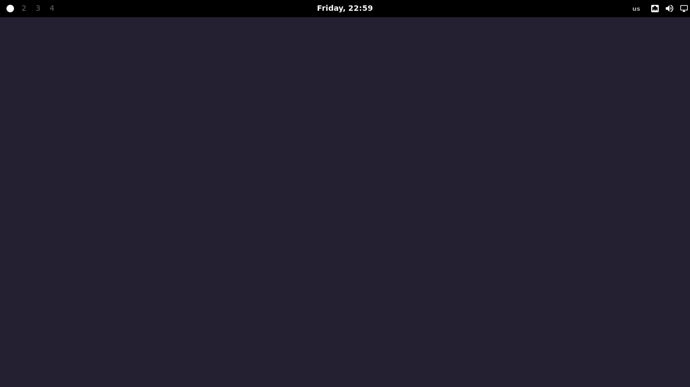

# Waybar

[English README](README.md)

Минимальная конфигурация Waybar на Nix.



Рабочие пространства находятся слева, часы - по центру, системные индикаторы - справа.

## Запуск

В GNOME панель запускается внутри тестового окна Sway:

```bash
nix run path:.
```

Закрыть окно: `Super+Shift+E`.

В Sway, Niri или другом совместимом композиторе:

```bash
nix run path:.#native
```

## Файлы

- `default.nix`: расположение панели и выбор композитора
- `modules/default.nix`: список модулей
- `modules/*.nix`: настройки отдельных модулей
- `style.css`: внешний вид панели
- `preview.nix`: локальный предпросмотр
- `flake.nix`: точки входа Nix

Композитор задаётся в `default.nix`:

```nix
compositor = "niri"; # или "sway"
```

После изменений перезапустите Waybar.

## Home Manager

```nix
imports = [ inputs.my-waybar.homeManagerModules.default ];
```

Для отображения иконок в системе должен быть установлен `Symbols Nerd Font`.
